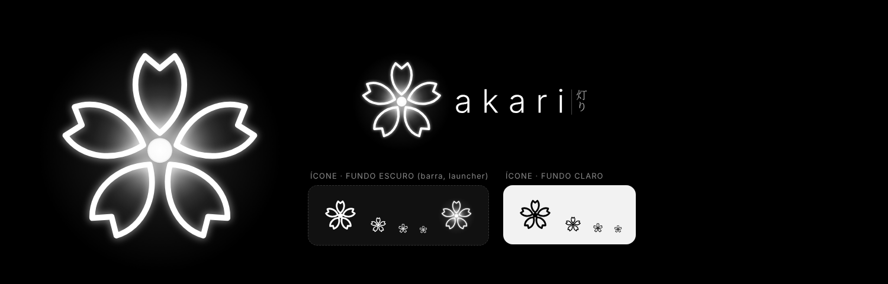

<p align="center">
  
</p>

<p align="center"><b>Akari 灯り</b>: um Fedora atômico com o visual do Caelestia, feito para jogar e programar.</p>

<p align="center">
  
</p>

> Prévia animada do boot até o desktop: [`branding/previews/akari-previa-boot-ate-desktop.mp4`](branding/previews/akari-previa-boot-ate-desktop.mp4)

---

## O que vem na Akari

| | |
|---|---|
| **Base** | Fedora atômico (bootc) via Universal Blue `base-main`: drivers AMD/Mesa completos, codecs e Flathub |
| **Desktop** | Hyprland + **Caelestia Shell** (Quickshell): barra lateral, launcher, painel de configurações, wallpapers, visualizador de áudio |
| **Cores** | Preto e branco (variante *Monochrome* do Material You), seguindo o wallpaper |
| **Boot** | Animação própria no Plymouth: a flor se desenha e acende |
| **Login** | **Genkan** 玄関: tema próprio do SDDM com a flor animada |
| **Transição** | **Hajime** はじめ: depois da senha, a flor desabrocha, a luz toma a tela e aparece "おかえり" |
| **Loja** | **Ichiba** 市場: loja própria (Flathub) + atualização e "voltar versão" do sistema |
| **Apps** | kitty, Dolphin, Firefox, VS Code, JetBrains Toolbox (instala no 1º login) |
| **Jogos** | Steam (Proton), Heroic (Epic/GOG/Amazon), GameMode, MangoHud, Gamescope |

Os apps de terceiros não são modificados: só ganham as cores do sistema.

---

## Como funciona

A Akari é uma **imagem de sistema** (igual à Bazzite). O GitHub Actions monta a imagem todo dia a partir deste repositório e publica no GitHub Container Registry. O notebook baixa a imagem nova inteira e aplica no próximo boot.

- **Atualizar** não quebra o sistema pela metade: ou a versão nova entra inteira, ou nada muda.
- Se algo der errado, dá para **voltar para a versão anterior** (pela Ichiba ou no menu de boot).
- Seus arquivos, configurações e apps Flatpak ficam intactos entre versões.

---

## Passo a passo

### 1. Criar o repositório

1. Crie um repositório no GitHub chamado **`akari`** (público é mais simples).
2. Suba todo o conteúdo deste zip.
3. Edite o `akari.env` e troque `seu-usuario` pelo seu usuário do GitHub.
4. Em **Settings → Actions → General → Workflow permissions**, marque **Read and write permissions**.

### 2. Gerar a imagem

1. O push já dispara o workflow **"Akari · construir imagem"** (aba *Actions*). Ele leva uns 30 a 40 minutos.
2. Quando terminar, vá no seu perfil → **Packages → akari → Package settings** e mude a visibilidade para **Public**. Sem isso, o instalador e as atualizações não conseguem baixar a imagem.

### 3. Gerar a ISO

1. Em *Actions*, abra **"Akari · gerar ISO e imagem de VM"** → **Run workflow** (plataforma `amd64`).
2. Baixe a ISO no Release **iso-latest** (vem em partes: baixe todas e rode o `juntar-iso`). O artefato `qcow2` é uma imagem pronta para máquina virtual.
3. **Instalador personalizado (experimental):** no mesmo workflow, escolha `instalador: personalizado`. Sai no Release **iso-personalizado**: o instalador já abre em português/Brasil (teclado ABNT2, fuso de São Paulo) e com o visual preto e branco da Akari. O visual é gerado por `branding/fonte/gerar-instalador.py`.

### 4. Testar numa VM antes (recomendado)

Use o GNOME Boxes, o virt-manager ou o VirtualBox com **UEFI**, **4 GB+ de RAM**, **40 GB de disco** e **aceleração 3D** ligada. Também dá para fazer localmente com `just build && just build-qcow2 && just run-vm-qcow2` (exige `podman` e `just`).

### 5. Instalar no notebook

1. Grave o `install.iso` num pendrive (Fedora Media Writer, Ventoy ou balenaEtcher).
2. Boote pelo pendrive. No instalador:
   - escolha o **teclado** (ex.: Português Brasil ABNT2);
   - escolha o **disco** (atenção: a instalação automática apaga o disco escolhido);
   - **crie seu usuário** e marque **"tornar administrador"**.
3. Reinicie: boot animado → Genkan → Hajime → desktop.

> **Já tem um Fedora atômico** (Silverblue, Bazzite, Aurora…)? Dá para trocar sem reinstalar:
> `sudo bootc switch ghcr.io/vinicius-r-oliveira/akari:latest` e reinicie.

---

## Primeiro login

Na primeira vez que você entra, a Akari:

- copia os configs do Caelestia (Hyprland, fish, fastfetch, btop) para a sua pasta;
- coloca os 15 wallpapers da Akari em `Imagens/Wallpapers` (8 parados + 7 animados) e aplica o principal com as cores em preto e branco;
- instala o **Heroic** (Flatpak) em segundo plano, assim que houver internet;
- baixa o **JetBrains Toolbox**. Abra pelo launcher para instalar IntelliJ, PyCharm, WebStorm etc.

## Atalhos principais

| Atalho | Ação |
|---|---|
| `Super` (aperta e solta) | Launcher (digite `>` para comandos: wallpaper, cores, calculadora…) |
| `Super + T` | Terminal (kitty) |
| `Super + E` | Arquivos (Dolphin) |
| `Super + W` | Firefox |
| `Super + C` | VS Code |
| `Super + Q` | Fechar janela |
| `Super + F` | Tela cheia |
| `Super + 1…0` | Trocar de área de trabalho |
| `Super + Alt + 1…0` | Mover janela para outra área |
| `Super + L` | Bloquear |
| `Super + V` | Histórico da área de transferência |
| `Print` / `Super + Shift + S` | Captura de tela |
| `Ctrl + Alt + Delete` | Menu de sessão (sair, reiniciar, desligar) |

A lista completa está no [README do Caelestia](https://github.com/caelestia-dots/caelestia#default-keybinds).

---

## Personalizar

| O quê | Onde |
|---|---|
| Apps padrão, atalhos, blur, bordas | `~/.config/caelestia/hypr-vars.lua` |
| Monitores, regras de janela, atalhos extras | `~/.config/caelestia/hypr-user.lua` |
| Barra, launcher, transparência, visualizador | `~/.config/caelestia/shell.json` (ou o painel de configurações do Caelestia) |
| Wallpapers | coloque imagens em `Imagens/Wallpapers` e troque pelo launcher (`>wallpaper`). Cada wallpaper da Akari já muda o tema inteiro (claro/escuro, preto e branco, pêssego ou rosa) |
| Wallpapers animados | escolha os de capa 08 a 12, 14 e 15 (Hanami Ugoki, Yozakura, Ame, Mangetsu, Fubuki, Sakura no Ki, Harukaze). Para usar um vídeo seu: ponha `nome.mp4` em `Imagens/Wallpapers/animados/` junto de uma imagem `nome.jpg` em `Imagens/Wallpapers` e escolha a imagem |
| Desligar os animados (economiza bateria) | `touch ~/.config/akari/no-animated` e escolha o wallpaper de novo |
| Cores coloridas em vez de preto e branco | launcher → `>variant` (ex.: *tonalspot*, *vibrant*) |
| Desligar a transição Hajime | `touch ~/.config/akari/no-hajime` |
| Não instalar o JetBrains Toolbox | `touch ~/.config/akari/no-jetbrains` |
| Flatpaks instalados por padrão (para todos) | `system_files/usr/share/akari/flatpaks.list` neste repositório |
| Pacotes do sistema | os scripts em `build_files/steps/` |

Não edite `~/.config/hypr/` direto: essa pasta acompanha as atualizações do Caelestia. Suas mudanças vão nos arquivos `hypr-*.lua`.

---

## Estrutura do repositório

```
akari/
├── Containerfile              # receita da imagem (base: ublue base-main)
├── akari.env                  # nome da imagem e seu usuário do GitHub
├── Justfile                   # comandos locais (build, VM, ISO)
├── .github/workflows/         # build diário da imagem + geração da ISO
├── disk_config/               # configuração do instalador (ISO) e da VM
├── build_files/
│   ├── build.sh               # roda as etapas em ordem
│   ├── steps/                 # 00 arquivos · 10 repositórios · 20 desktop · 30 apps
│   │                          # 40 jogos · 50 login/boot · 60 identidade · 90 finalização
│   └── fallback/              # plano B: compila o Caelestia do código-fonte
├── system_files/              # tudo que é copiado para dentro do sistema
│   ├── etc/sddm.conf.d/              # SDDM usando a Genkan
│   ├── etc/xdg/quickshell/akari-hajime/   # Hajime (transição)
│   ├── usr/share/sddm/themes/genkan/      # Genkan (login)
│   ├── usr/share/plymouth/themes/akari/   # animação de boot
│   ├── usr/lib/akari/ichiba/              # Ichiba (loja, Python + QML)
│   ├── usr/share/akari/                   # logo, wallpapers, padrões, ajustes do Hyprland
│   └── usr/bin, usr/libexec/akari/        # sessão, setup do usuário, utilitários
└── branding/                  # logo (SVG/PNG), prévias e os scripts que geram a arte
```

### Refazer a arte

```bash
pip install playwright pillow fonttools && playwright install chromium
python3 branding/fonte/gerar-logo.py     # SVGs do logo
python3 branding/fonte/gerar-assets.py   # PNGs, wallpapers, fundo do login, quadros do boot
```

Os wallpapers são páginas HTML em `branding/fonte/wallpapers/`. Mude o texto, as posições e as pétalas e gere de novo.
Os animados ficam em `branding/fonte/wallpapers/animados/` e viram vídeo com `python3 branding/fonte/gerar-animados.py` (precisa do `ffmpeg`). O tema de cada wallpaper fica em `system_files/usr/share/akari/wallpapers/temas.json`.

### Testar a Ichiba fora da Akari

```bash
AKARI_ICHIBA_DEMO=1 python3 system_files/usr/lib/akari/ichiba/ichiba.py
```

---

## Problemas comuns

- **O build falhou instalando o `caelestia-shell`**: o script já tenta compilar do código-fonte sozinho. Se ainda falhar, rode de novo o workflow mais tarde, porque os repositórios COPR às vezes ficam fora do ar.
- **A ISO não baixa a imagem / as atualizações falham**: o pacote `akari` no GHCR precisa estar **público**.
- **Tela preta depois do login**: `Ctrl + Alt + F3`, entre com seu usuário e veja `~/.local/state/akari/` e `journalctl --user -b`. Para voltar à versão anterior: `rpm-ostree rollback && systemctl reboot`.
- **Teclado errado na tela de login**: a Genkan usa o layout escolhido na instalação. Para trocar: `sudo localectl set-x11-keymap br abnt2` (exemplo).
- **Placa NVIDIA**: esta imagem foi pensada para AMD/Intel. Para NVIDIA, a base precisa ser trocada pela variante `-nvidia` da Universal Blue.

---

## Créditos e licenças

- [Caelestia](https://github.com/caelestia-dots) (shell, CLI e dotfiles), GPL-3.0
- [Hyprland](https://hypr.land) · [Quickshell](https://quickshell.org) · COPRs [nett00n/hyprland](https://copr.fedorainfracloud.org/coprs/nett00n/hyprland/), [errornointernet/quickshell](https://copr.fedorainfracloud.org/coprs/errornointernet/quickshell/), [celestelove/caelestia](https://copr.fedorainfracloud.org/coprs/celestelove/caelestia/)
- [Universal Blue](https://universal-blue.org) (imagem base e template), Apache-2.0
- Fontes: Google Sans Flex, Rubik e UnifrakturCook (OFL), JetBrains Mono / Caskaydia Cove Nerd Font (OFL), Material Symbols (Apache-2.0)
- Cursor [Bibata](https://github.com/ful1e5/Bibata_Cursor), GPL-3.0
- Haiku do wallpaper principal: Matsuo Bashō (domínio público)

O código próprio da Akari (scripts, Genkan, Hajime, Ichiba, arte) está sob Apache-2.0.
